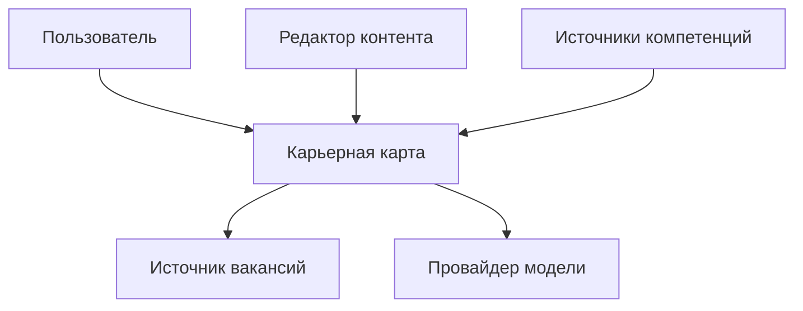
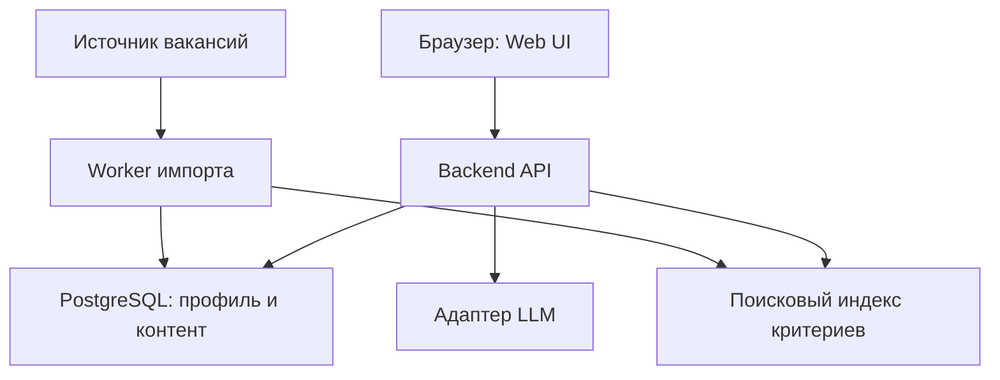
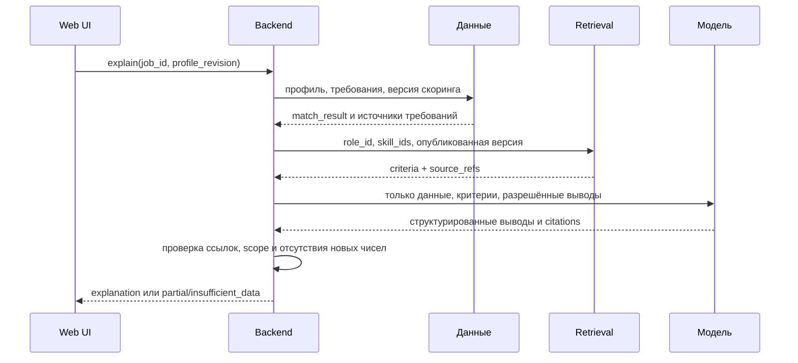

# Software Architecture Document
Статус: PROPOSED. Структура по темам arc42; диаграммы контекста и контейнеров передают уровни C4, без заявления о формальной сертификации нотации.

## 1. Цели
Объяснимые оценки, воспроизводимый скоринг, прозрачный контент всех IT-ролей, короткая разработка, возможность работы без внешнего API/LLM. Ключевые требования FR07–FR12 и NFR01–NFR04.

## 2. Ограничения
Командный студенческий проект, 4–8 недель; состав команды, бюджет и hosting OPEN. Нельзя публично публиковать приложение без отдельной авторизации пользователя. Нет лицензий на закрытые матрицы по умолчанию. Реальные данные персонала банка не используются.

## 3. Контекст

Профиль пользователь задаёт сам. Из источника вакансий поступают описания и зарплаты; ключи остаются на сервере. Провайдер модели получает минимальный контекст без контактов. Источники компетенций поступают через проверяемый импорт, не напрямую в production.

## 4. Стратегия
Предлагается модульный монолит: frontend React/TypeScript, backend Python/FastAPI, PostgreSQL с JSONB и векторным расширением; worker использует тот же backend-код. Это отправная точка, не навязанный выбор пользователя. Ранний прототип может использовать in-memory/demo-адаптеры по тому же контракту. Версии библиотек фиксируются lock-файлами при реализации, а не угадываются здесь.
Не требуются Kubernetes, графовая БД, микросервисы или агентная оркестрация.

## 5. Контейнеры и модули

DB и индекс могут быть одной физической PostgreSQL. Логическое разделение на схеме не означает два сервера.
Модули: taxonomy; profile; assessment; matching; market; knowledge; explanation; cover_letter; ingestion; content_admin. Межмодульные вызовы через сервисные интерфейсы; числовой расчёт не вызывает LLM. DTO API не содержат ключи ответов. Worker публикует snapshot атомарно.

## 6. Runtime
### Объяснение вакансии

Модель не выбирает владельца профиля; это делает сервер по сессии. Обновление профиля во время расчёта создаёт новый результат; старый помечается устаревшим, не переписывается.

### Импорт
Получить данные → staging → нормализовать → проверить права и структуру → дедуплицировать → сохранить snapshot → атомарно переключить active pointer → обновить индекс. Провал не ломает последний успешный snapshot. Источники вопросов публикуются отдельно от retrieval-корпуса.

## 7. Развёртывание
Dev: UI + API + PostgreSQL + mock LLM/job adapter. Private demo: HTTPS reverse proxy, одна API-служба, worker по расписанию, приватная БД, резервные копии. Prod — отдельное решение после оценки нагрузки и прав на источники. Схема доверия: публичен только reverse proxy; DB/worker и секреты не доступны клиенту.

## 8. Сквозные концепции
UTC внутри; локальное отображение; UUID/стабильные текстовые ID; versioned DTO; request_id; optimistic locking профиля; идемпотентное завершение попытки; source provenance; provider timeout; разрешённый список доменов для импорта; неизменяемые опубликованные версии; privacy-by-default; контроль demo/live.
Список библиотек и поставщик LLM меняются без изменения доменной модели. Валюта и налоговый режим не теряются при нормализации.

## 9. Решения
См. ADR001–ADR006. Все новые технические решения Proposed до ревью команды. Подтверждённый охват всех IT-направлений не является предметом повторного сокращения до QA.

## 10. Качество
См. NFR01–NFR10, контрольные наборы и тест-план. Сначала измерить качество retrieval и скоринга на фиксированных данных; не оценивать систему одной «красивой» демонстрацией.

## 11. Риски
Неполное покрытие ролей; неодинаковые критерии компаний; невалидные тесты; недоступность job API; расходы LLM; устаревшие вакансии; смешение demo/live. Меры и владельцы определяются в risk register.

## 12. Словарь
См. docs/15_glossary.md. Различаются skill, technology, criterion, evidence, scope, grade model, snapshot и match score.
