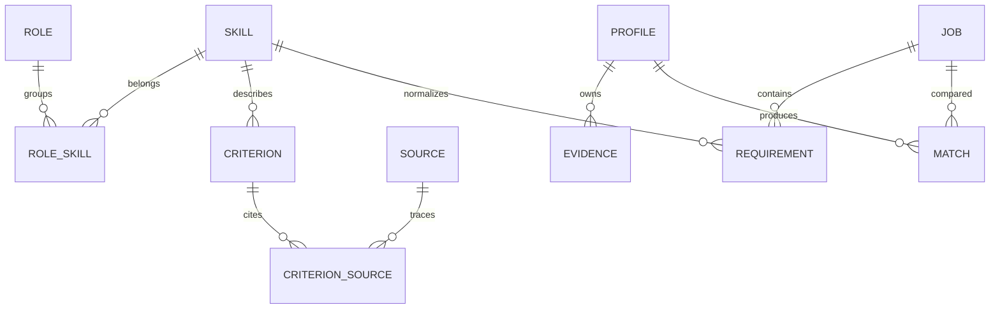

# Модель данных и жизненный цикл
Формат обмена: schemas/domain.schema.json. Физические SQL-таблицы ниже — проект, а не применённые миграции.

| Сущность | Ключ и важные поля | Связи / ограничения |
|---|---|---|
| Role | id, family, title, coverage | Несколько стеков; доступность критериев и тестов независима |
| Skill | id, kind, title, aliases | kind: knowledge/competency/technology/responsibility; общий ID переиспользуется |
| RoleSkill | role_id, skill_id, relevance | Не каждый навык обязателен для каждого стека |
| Source | id, url, version, license, usage_status | Лицензия и право импорта отдельно от возможности открыть URL |
| Criterion | id, skill_id, role_id, dimension, scope_id, level, source_ids, status | review_status и version; draft исключён из production |
| GradeProfile | id, role_id, grade, criterion_ids, required_dimensions, version | Нельзя автоматически отождествить разные корпоративные шкалы |
| Profile | id, owner_session_id, role_id, revision | Revision растёт при мутации; пользователь не задаёт owner |
| Evidence | id, skill_id, scope_id, kind, credit, assessed_at, bank_version | self_report отдельно от quiz/case; неизменяемая история |
| Assessment | id, owner, skill_id, bank_version, state | not_started/in_progress/completed/expired/review_required |
| Question | id, bank_version, criterion_ids, scope_id, options, key | Только server-side ключ; отдельный PublicQuestion |
| Job | id, source_id, source_url, status, mode, timestamps | Уникальность source_id + external_id; snapshot immutable |
| Requirement | id, job_id, skill_id, scope_id, expected_credit, weight, mandatory | Исходный excerpt обязателен; ambiguous не скрывать |
| Match | id, profile_revision, job_snapshot, scoring_version, rows | Числа из кода; explanation ссылается на Match |
| Explanation | id, match_id, corpus_version, citations, status | Без source_ids вывод не публикуется как обоснованный |

## Связи

ER — логические отношения; version входит в физические FK, если сущность версионируется.

## Доказательства и противоречия
self_report означает заявление, а не верификацию опыта. quiz подтверждает конкретный scope, не все уровни навыка. Не брать максимум из всех исторических попыток: активная политика выбирает последнее действующее доказательство по scope; конфликт с более свежей неудачей показывается явно. Срок действия задаётся политикой и не придумывается моделью.
Удаление навыка из карты не удаляет историю завершённых попыток без явного удаления профиля; он перестаёт участвовать в активном поиске. Смена роли не стирает общие знания, но не переносит роль-специфичную ответственность.

## Состояния контента
Draft → In review → Published → Retired. Новый Published не меняет старые результаты; они сохраняют версии. Retired не участвует в новых вычислениях, но доступен в аудите существующего результата, если разрешено хранение.

## Вакансии
live / demo — режим данных. active / archived / stale — статус. fetched_at не заменяет published_at. last_seen_at и archived_at хранятся отдельно. source_url nullable только в demo. Отсутствующая зарплата — null, не 0.

## Удаление и retention — PROPOSED
Гостевые данные: удаление по кнопке; неактивные гостевые сессии очищаются через 30 дней. Незавершённые попытки истекают через 7 дней; completed хранятся до удаления профиля/сессии. Логи 14 дней без текста ответов; snapshots не содержат персональные профили. Бэкапы очищают удалённые данные по циклу до 30 дней. Эти сроки требуют подтверждения команды перед запуском.
